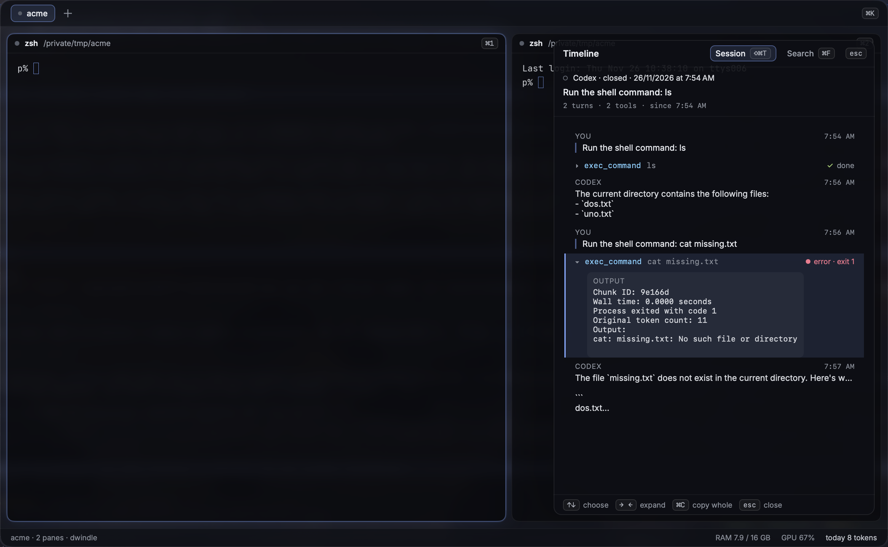
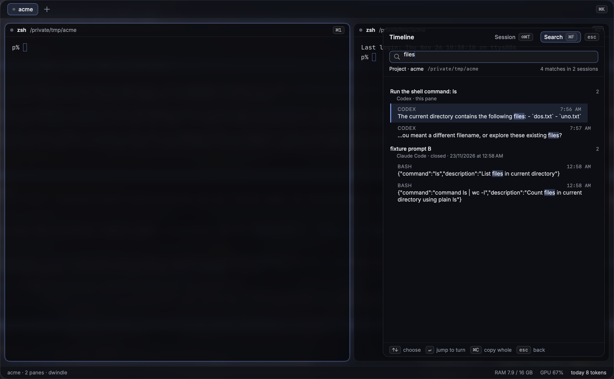
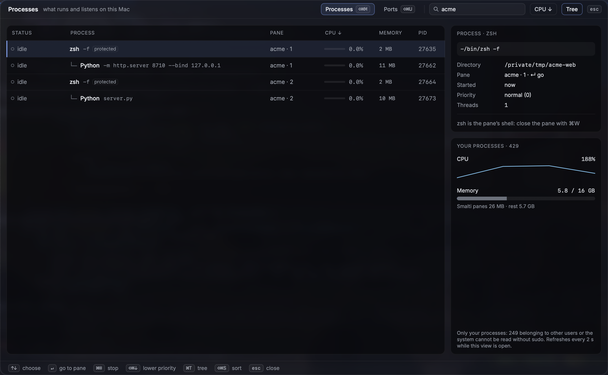
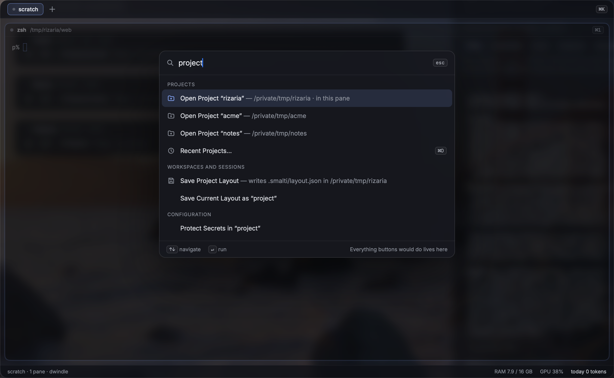
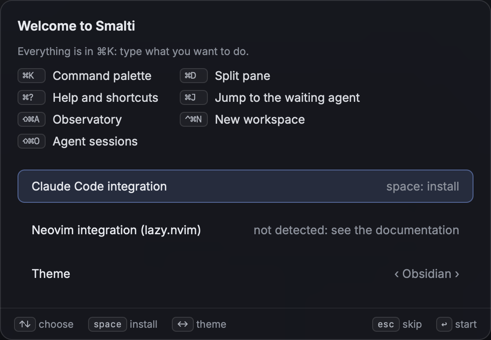

<p align="center">
  <a href="https://smalti.sh"></a>
</p>

<h1 align="center">Smalti</h1>

<p align="center">
  <strong>A native macOS terminal for working with several AI agents at once.</strong><br>
  Tiling, each agent's state at a glance, sessions you can resume and a timeline of everything they did.
</p>

<p align="center">
  <a href="https://github.com/simonriv/smalti/releases/latest"></a>
  
  <a href="LICENSE"></a>
  <a href="https://smalti.sh/es"></a>
</p>

<p align="center">
  <a href="https://smalti.sh">Website</a> · <a href="https://smalti.sh/docs">Docs</a> · <a href="https://smalti.sh/es/docs">Documentación en español</a> · <a href="#install">Install</a>
</p>



## Why Smalti

Coding agents are great at working in parallel and terrible at telling you what they did. Smalti is a terminal built around that: you see which agent works, which one waits for you and which one failed, and you can get back every turn even after it scrolled away. It is native (Swift + AppKit on [libghostty](https://github.com/ghostty-org/ghostty)), keyboard-first (every action has a shortcut and lives in ⌘K, no fixed buttons) and quiet: nothing runs or watches the disk unless you open it.

## What it does

| | |
| --- | --- |
| **Tiling and agent state.** Dwindle, columns or master + stack; every pane shows its agent working (green), waiting for you (amber) or failed (red). ⌘J jumps to the one waiting. | **Session timeline (⇧⌘T).** Every turn of Claude Code and Codex, tools folded with their status, searchable across the project and copyable whole. |
| **Resume sessions.** Claude Code, Codex, Antigravity and OpenCode come back where they were when you reopen Smalti, with ⇧⌘O to search them all. | **Observatory (⇧⌘A).** Tokens, cost estimate, context and activity per session, local models and your Mac's CPU, GPU and memory. |
| **Ports and processes (⇧⌘U, ⇧⌘M).** What listens and what runs, which pane started it, and stopping it safely (SIGTERM first, confirmation before SIGKILL). | **Guards for agents.** Destructive commands against production and reads of secrets pause for your approval in a native card. |
| **Projects (⌘O).** A repo's layout lives in `.smalti/layout.json` and opens with its panes and commands, after you approve them. | **Yours to tweak.** Themes, a prompt studio, Neovim beside the agent, shareable layouts, English and Spanish. |

<table>
  <tr>
    <td></td>
    <td></td>
  </tr>
  <tr>
    <td></td>
    <td></td>
  </tr>
</table>

## At a glance

- Free and open source (MIT). macOS 27 or later, on Apple silicon only.
- The interface is in English or Spanish, following your Mac's language (System Settings → General → Language & Region, also per app).
- It only goes online to check for updates on smalti.sh and download them from GitHub: no accounts, no telemetry sent anywhere.

## Install

### With the DMG

1. Download [`Smalti.dmg`](https://github.com/simonriv/smalti/releases/latest/download/Smalti.dmg) from the [latest release](https://github.com/simonriv/smalti/releases/latest).
2. Open it and **drag Smalti to Applications**. Don't open it from the DMG: macOS would run it from a temporary copy and it couldn't update itself.
3. Open it from Applications and follow "First open".

### With Homebrew

```sh
brew install --cask simonriv/tap/smalti
```

Homebrew installs it in Applications with the downloaded-from-the-internet mark, so it also asks for "First open".

### From source

```sh
git clone --recurse-submodules https://github.com/simonriv/smalti.git
cd smalti
scripts/bootstrap
xcodebuild -project App/Smalti.xcodeproj -scheme Smalti -configuration Release -derivedDataPath build build
```

The app ends up in `build/Build/Products/Release/Smalti.app`. What you build on your Mac carries no download mark, so there is no first-open warning. It's the same app as the DMG: it checks for updates on smalti.sh and offers the official version when a new one comes out (turn it off with ⌘K → "Turn Off Automatic Updates"). You need Xcode 27 and Homebrew (`scripts/bootstrap` installs Zig and the Metal Toolchain and builds libghostty).

## First open

Smalti has no Apple developer signature (it's signed *ad hoc*) and isn't **notarized** (that costs USD 99 a year and Smalti is free); its updates are signed with Smalti's EdDSA key. The first time you open it, macOS says it couldn't verify it. There are two ways to open it; both are one-time.

**From macOS's settings**

1. Open Smalti. macOS says "“Smalti.app” Not Opened" because it couldn't verify it; click **Done**.
2. Open **System Settings → Privacy & Security**, scroll down to "Security" and, next to "“Smalti” was blocked to protect your Mac.", click **Open Anyway**.
3. macOS may ask once more: click **Open Anyway** again and authenticate with your password or Touch ID.

**From the terminal**

```sh
xattr -dr com.apple.quarantine /Applications/Smalti.app
```

## First launch

On a fresh install Smalti opens a short welcome card: ⌘K and the key shortcuts, the Claude Code and Neovim integrations (space installs each one) and the theme (←→). ↩ starts, esc skips; reopen it any time from ⌘K → "Welcome to Smalti" or the help (⌘?).

- **Claude Code:** the integration is a Claude Code plugin with hooks that tell Smalti what each agent does.
- **Neovim:** claudecode.nvim is installed as one file, `lua/plugins/smalti-claudecode.lua`, in configs that use lazy.nvim and import `plugins` (NvChad, the LazyVim starter, or your own). Other setups: see https://smalti.sh/docs/integrations.
- **Keyboard:** ⌥ acts as Meta only on the U.S. layouts by default (`[keyboard] option_as_meta = "auto"`); set `"always"`, `"left"`, `"right"` or `"never"` in `~/.config/smalti/config.toml`. Shortcuts never use ⌥ without ⌘ or ⌃.
- **Shell:** prompt integration, suggestions and history are for zsh.

## Updates

Smalti checks for a new version once a day (and when you choose "Check for Updates…" in the Smalti menu or ⌘K) and asks before installing it. Every version is signed with Smalti's EdDSA key: a download without that signature is rejected. Updates don't show the first-open warning again.

## Privacy

That update check is **the only thing that leaves your Mac**: Smalti sends no usage or system data (`SUEnableSystemProfiling = NO`). Claude Code's telemetry is received on `127.0.0.1` and never leaves your Mac; Ollama is asked on `127.0.0.1`. If you install claudecode.nvim, lazy.nvim downloads it from GitHub the next time you open Neovim. Turn the update check off with ⌘K → "Turn Off Automatic Updates". Details: the "Privacy" section of the help (⌘?) and https://smalti.sh/privacy.

Limitations of not being notarized:

- The first open needs "Open Anyway" or `xattr`.
- If you grant Smalti privacy permissions (Accessibility, Automation, protected folders), macOS may ask again after an update, because each version has a different signature.
- If you open Smalti without moving it to Applications, it can't update itself (it will tell you).

## Uninstall

Drag `Smalti.app` to the Trash. Its configuration and state live in `~/.config/smalti` and `~/Library/Application Support/Smalti`; delete them to start from scratch. With Homebrew: `brew uninstall --cask smalti` (add `--zap` to delete those folders too).

## Contributing

Smalti takes issues, not pull requests: see [CONTRIBUTING.md](CONTRIBUTING.md). To report a bug or an idea from the app: ⌘K → "Report a Problem or Idea…".

## Support

Smalti is free. If it saves you time, you can support it at https://smalti.sh/#support.

## License

[MIT](LICENSE). Third-party components and their licenses are in [THIRD_PARTY_NOTICES.md](THIRD_PARTY_NOTICES.md), which also ships inside the app.
